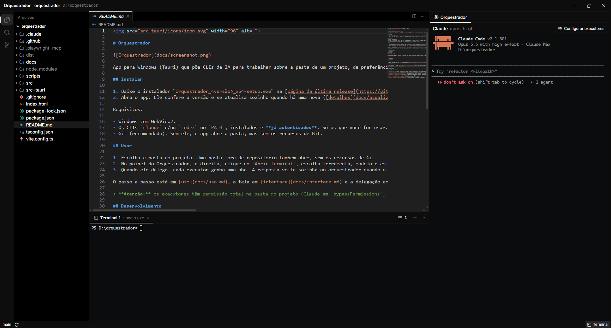

# Orquestrador



## 1. O que é

Um app para Windows (Tauri) que põe CLIs de IA para trabalhar em papéis separados sobre a pasta de um projeto, de preferência um repositório Git. Cada CLI tem uma aba no painel do Orquestrador, à direita da tela principal, com o terminal dele ao vivo. O orquestrador alinha o objetivo com o usuário, lê o projeto, delega e, quando o usuário pede, faz stage, commit e push; os executores recebem as tarefas, cada um na sua aba, e trabalham na pasta do projeto em paralelo. As ferramentas `claude` e `codex` podem ocupar qualquer um dos dois papéis.

## 2. Requisitos

- Windows com WebView2.
- Git (recomendado: sem ele, o app abre a pasta sem os recursos de Git).
- Os CLIs `claude` e `codex` no `PATH`, somente os que forem usados.
- Para compilar: Node.js e Rust (toolchain MSVC).

## 3. Como rodar

```powershell
npm install
npm run tauri dev      # desenvolvimento: uso liberado direto, sem consultar atualizações
npm run tauri build    # gera o instalador assinado em src-tauri\target\release\bundle\nsis (exige a chave, seção 8)
```

## 4. Como se usa

1. Abra o app. Antes da escolha da pasta, ele confere a versão e atualiza sozinho se houver uma nova (seção 8). Depois, escolha a pasta do projeto. Uma pasta dentro de um repositório abre a raiz dele, como antes; se a pasta escolhida for uma subpasta, um aviso diz qual é a raiz e que o projeto aberto é ela. Uma pasta fora de repositório abre normalmente, sem os recursos de Git (ver a tela Git, abaixo). Uma pasta que não existe é recusada.
2. No painel do Orquestrador, à direita da tela principal, sem orquestrador aberto, clique em `Abrir terminal` e escolha ferramenta, modelo e esforço do orquestrador; a última escolha já vem marcada. Sem Git na pasta, a janela avisa que o que os executores mudarem não fica registrado e não pode ser desfeito pelo Git, e diz o que fazer conforme o caso: inicializar o repositório no painel Git, instalar o Git ou abrir a raiz do repositório. O aviso não bloqueia. Há um só orquestrador, e é no terminal dele que você conversa com ele; os executores só mostram o que fazem.
3. Converse com o orquestrador e feche o objetivo.
4. Na primeira delegação, uma aba de executor aparece e espera a escolha de ferramenta, modelo e esforço; a aba ativa não muda. Os executores seguintes abrem sozinhos com essa escolha. O botão `Executores`, na barra da aba do orquestrador, mostra a escolha e deixa trocá-la; a troca vale para os próximos.
5. O orquestrador delega um lote e fica ocupado até todos voltarem. Cada executor tem uma aba com a tela completa do CLI, somente leitura, ligada ao orquestrador. Acima do teto de simultâneos, os excedentes ficam na fila. O teto não é ajustado à mão: o app o calcula (seção 6), e a fila anda sozinha quando a memória livre volta.
6. Quando um executor termina a rodada, a resposta dele volta sozinha ao orquestrador e a aba dele fecha sozinha. O botão `parar` interrompe só aquele executor; o orquestrador recebe `interrompido pelo usuário` no lugar da resposta.
7. Se o CLI de um executor parar num pedido de confirmação, a aba e a barra dela passam a `aguardando orquestrador`, e o executor continua ocupando o seu lugar no teto de simultâneos. Quem responde é o orquestrador, não você: ele recebe a pergunta com a ferramenta e o comando e aceita, ou recusa com um motivo que vai ao executor (seção 5). Você não precisa agir na aba. O botão `parar` continua valendo ali e encerra o executor como interrompido.
8. Fechar o app com alterações não salvas abre a confirmação: Salvar (grava tudo; se algo falhar ou sobrar texto novo, o app não fecha), Descartar (joga a edição fora e fecha) ou Cancelar (nada muda). Com terminais vivos, a confirmação também encerra todos, os shells do painel Terminal inclusive; os shells não contam para a confirmação. Nada de shell ou CLI é restaurado na próxima abertura. As abas, o layout e os rascunhos que ficam (quando não houve descarte) voltam; o que já mudou nos arquivos fica no projeto.

A tela principal tem, à esquerda, a coluna de ícones (Arquivos, Pesquisar e Git) e, ao lado dela, uma faixa com o conteúdo da tela escolhida: a árvore de pastas, a pesquisa ou a barra lateral do Git. A faixa abre com 280 px e a borda direita dela arrasta a largura, que é a mesma nas três telas. À direita da faixa fica a coluna central, sempre montada, com o editor (grupos, abas, diffs, commits e conflitos) em cima e o painel Terminal embaixo. À direita de tudo fica o painel do Orquestrador, que aparece em todas as telas e não muda de tamanho com a troca delas. Trocar de tela só troca o conteúdo da faixa: a área central não é desmontada nem muda de tamanho, e as abas abertas ficam como estavam.

O painel do Orquestrador tem uma faixa de abas em cima: a primeira é o Orquestrador, fixa, e cada executor tem uma aba só com o ícone do estado e o número `#N`. Com muitas abas, a faixa rola na horizontal, com a roda do mouse em cima dela; não há barra de rolagem visível. Embaixo da faixa fica a barra da aba ativa e, abaixo dela, o terminal da aba. Na aba do orquestrador, a barra mostra a escolha dele (ferramenta, modelo e esforço) e o botão `Executores`. Na aba de um executor, a barra mostra o estado (exceto em execução, que já aparece no ícone girando da aba), o número, o título da tarefa, a escolha e o botão `parar`; o que não cabe encolhe com reticências. Trocar de aba não desmonta nenhum terminal: os outros só ficam escondidos. Dentro de um terminal, a roda do mouse rola o terminal. Sem orquestrador aberto, o botão `Abrir terminal` aparece no próprio painel.

O painel do Orquestrador abre com 520 px. A borda esquerda dele arrasta para mudar a largura, e o duplo clique nela volta para 572 px. A largura vai de 320 px até o que deixa pelo menos 240 px para a coluna central, com a faixa da árvore na largura em que está. Se a janela encolhe, o painel encolhe primeiro, até 320 px, e só depois a faixa da árvore, até 200 px; quando a janela cresce de volta, cada um volta à largura que o usuário deu. A largura fica guardada por projeto, junto com a altura do Terminal e a largura da faixa e dos grupos (seção 9): ao reabrir o projeto, o layout volta como estava. Ele fica encostado nas bordas da janela, sem cartão em volta.

Embaixo da área do arquivo, na coluna central, o painel Terminal abre PowerShells do usuário na pasta do projeto, com a largura da coluna central. Cada shell tem uma aba na faixa de cima do painel, com o ícone e o título `<pasta do projeto> — <programa>` (por exemplo `orquestrador — pwsh.exe`; o programa é `pwsh.exe` ou, se ele não existir, `powershell.exe`; até o backend responder, o título é só a pasta). O `×` da aba fecha aquela aba e encerra o shell dela; o `+` depois da última aba abre um shell novo, que vira a aba ativa. Com muitas abas, a faixa rola na horizontal, com a roda do mouse em cima dela; não há barra de rolagem visível. Trocar de aba não desmonta nenhum terminal: os outros só ficam escondidos. O painel abre pelo botão `Terminal` na barra de status (embaixo, à direita) ou pelo atalho Ctrl+crase (tecla `` ` ``), que funciona também com o foco dentro de um terminal; começa fechado. A borda de cima do painel arrasta para mudar a altura (abre com 280 px; a altura fica guardada por projeto, como a largura do painel do Orquestrador; o mínimo é 120 px, e o máximo deixa pelo menos 160 px para a área do arquivo). O botão de seta para baixo, à direita da barra, só esconde o painel: todos os shells continuam rodando e, ao reabrir, as abas e os terminais estão como estavam. Digitar `exit` encerra só o shell daquela aba, e a aba some. Fechar ou encerrar a última aba fecha o painel, e o próximo `Terminal` abre um shell novo. Os shells não dependem do orquestrador: abrem com ou sem ele aberto e continuam vivos quando o orquestrador termina. O painel fica embaixo da área do arquivo nas três telas (Arquivos, Pesquisar e Git), e trocar de tela não fecha nem reinicia os shells. Ao reabrir o app, o painel volta fechado e sem shells: nenhuma sessão de shell é restaurada.

A coluna de ícones tem três telas: Arquivos, Pesquisar e Git. Arquivos mostra a árvore de pastas; Pesquisar mostra a pesquisa de texto no lugar da árvore; Git mostra a barra lateral do controle de versão (ou o histórico). O ícone da tela aberta fica marcado. O ícone do Git mostra um contador com os arquivos alterados (some quando é zero; sem repositório, não aparece). A árvore mostra a pasta do projeto: pastas abrem e fecham com um clique e a árvore se atualiza sozinha a cada 1,5 s. O visual segue o Explorer do Antigravity/VS Code: os ícones por tipo de arquivo e por nome de pasta são os do tema Symbols (o padrão da IDE); com repositório, o nome do item ganha a cor e a letra do Git (M modificado, U não rastreado, A novo no índice, R renomeado, D apagado, ! em conflito), a pasta com algo alterado dentro herda a cor da alteração mais forte com um `•`, e o que o `.gitignore` ignora fica em cinza. Em cima da árvore, a barra Arquivos traz, com o ponteiro ou o foco no painel, Novo Arquivo e Nova Pasta (na pasta selecionada, ou na do arquivo selecionado; sem seleção única, na raiz), Atualizar e Recolher Tudo; abaixo dela, a seção com o nome da pasta do projeto recolhe e reabre a árvore inteira. Clicar num arquivo abre uma prévia na área central (um clique só); a prévia é substituída pelo próximo clique simples. Duplo clique, Enter ou editar o texto torna a aba permanente. Shift+Enter e o duplo clique abrem de vez, e o item do menu “Abrir à Direita” põe o arquivo no grupo da direita (o segundo na ordem visual, mesmo com o foco nele; com um grupo só, cria o outro, à direita dele). Ctrl+P abre o arquivo rápido (ver abaixo). Na área central (com o foco no editor ou nas abas, nunca dentro do terminal nem de um campo): Ctrl+W ou Ctrl+F4 fecha a aba ativa, Ctrl+Tab troca de aba, Ctrl+\ divide em dois grupos, Ctrl+Shift+T reabre a última fechada, Ctrl+S salva. Acordes: Ctrl+K e depois W fecha as abas não fixadas do grupo ativo; Ctrl+K e depois Ctrl+Shift+C copia o caminho relativo da aba ativa; Shift+Alt+C copia o caminho absoluto; Ctrl+K e depois Shift+Enter fixa ou desafixa a aba ativa. O Ctrl+K vale por 1,5 s, e sair da área cancela o acorde. Os atalhos que o menu de cada aba mostra são estes mesmos.

O ícone Pesquisar põe a pesquisa de texto no lugar da árvore, na mesma faixa e com a mesma largura. A pesquisa procura o texto nos arquivos do projeto e pula os binários. Com repositório, a lista de arquivos vem do `git ls-files` e pula os ignorados pelo `.gitignore` e a pasta `.git`. Sem repositório, a lista vem da pasta percorrida com a crate `ignore` (a do ripgrep): respeita `.gitignore` e `.ignore` da pasta do projeto e das subpastas, mas não os de pastas acima; inclui arquivos ocultos; não segue links; pula sempre `.git` e `node_modules`; e pula subpasta que não dá para ler. O Ctrl+P e a substituição usam a mesma lista. Digitar busca depois de uma espera de 300 ms, e Enter busca na hora; o botão Atualizar refaz a busca. ArrowUp e ArrowDown no campo percorrem o histórico de consultas, as últimas 20, sem repetição, guardadas no navegador do app (`localStorage`, chave `orquestrador.search.history`); ArrowDown na mais recente volta ao texto digitado, e trocar pelo histórico não o reordena. Cada busca que roda leva a consulta ao topo. Os resultados ficam agrupados por arquivo, com o número da linha e a coluna (contadas em unidades UTF-16, como o editor: um emoji conta 2) e o trecho que casou destacado. Clicar num resultado abre o arquivo na linha e coluna como prévia; duplo clique ou Enter abrem de vez. F4 vai ao próximo resultado e Shift+F4 ao anterior, com volta, abrindo como prévia e sem tirar o foco do teclado; eles não valem com o foco num terminal. Cada arquivo recolhe e expande pelo cabeçalho. Cada arquivo e cada linha de resultado tem um X de dispensar, que aparece com o mouse ou o foco; a tecla Delete, com o foco numa linha, também a dispensa. Dispensar só tira o item da tela, sem mexer no disco, e uma busca nova o devolve. O clique direito num resultado abre o menu: na linha, Copiar (o texto da linha), Copiar caminho, Copiar tudo (os resultados que estão na tela) e Dispensar; no arquivo, Copiar caminho, Copiar tudo (o bloco dele) e Dispensar. Três botões à direita do campo ligam as opções: diferenciar maiúsculas de minúsculas (desligada por padrão), palavra inteira e expressão regular. A expressão regular usa a sintaxe do Rust (`regex`): sem lookaround (`(?=`, `(?!`, `(?<=`, `(?<!`) e sem referências como `\1`; a substituição aceita `$1` e `${nome}`. Uma regex inválida mostra a mensagem do backend e não busca. A busca devolve no máximo 2000 linhas casadas; com mais, a lista avisa que só os 2000 primeiros aparecem. A pesquisa pode ser limitada a uma pasta (o item “Localizar na Pasta…” do menu da árvore): o filtro e a prévia da substituição respeitam esse escopo. A substituição mostra a prévia antes de gravar, só nos arquivos marcados; arquivo com alteração não salva no editor fica desmarcado e não é gravado. O ícone de maiúsculas no campo Substituir por liga Preservar maiúsculas: a substituição segue a caixa de cada ocorrência (toda maiúscula, toda minúscula ou inicial maiúscula), na prévia e na aplicação, e mudar a opção fecha a prévia. Ctrl+Shift+F abre a pesquisa e foca o campo de qualquer lugar, inclusive com o foco num terminal, e só vale com projeto aberto. Com texto selecionado no editor (de uma linha só), esse texto vira a consulta e a busca roda na hora; sem seleção, a palavra sob o cursor faz esse papel. A pesquisa também se refaz sozinha quando o editor grava um arquivo, sem entrar no histórico e sem tirar o recolhido nem os dispensados; com a revisão de substituição aberta, espera.

A faixa abre com 280 px. A borda direita dela arrasta para mudar a largura (a mesma para árvore, pesquisa e Git), e o duplo clique nela volta para 280 px. A largura vai de 200 px até o que deixa pelo menos 240 px para a coluna central, com o painel do Orquestrador na largura em que está.

A tela Git põe na faixa a barra lateral do controle de versão: a branch atual (abre a lista das branches locais e um campo para criar uma nova, já trocando para ela); os botões Buscar, Receber e Enviar, com o número de commits que faltam; o campo da mensagem, com o botão Commit (Ctrl+Enter também commita); e as seções Preparadas e Alterações. Clicar numa linha abre a alteração (diff) na área central como prévia; duplo clique abre de vez. Preparadas e Alterações são abas diferentes do mesmo arquivo: a versão preparada e a não preparada não se misturam. O botão de cada linha prepara ou tira o arquivo. No diff de uma alteração não preparada, Descartar arquivo e Descartar bloco descartam essa alteração (seção 7). Um conflito abre o editor de conflito. O botão de histórico da barra abre os commits do projeto; o menu de um arquivo da árvore tem “Histórico Git”, que abre os commits que tocaram nele. Abrir um commit mostra a lista dos arquivos dele, e abrir um arquivo do commit mostra a alteração daquele commit, somente leitura. As abas de diff, commit e conflito ficam na área central e continuam abertas ao trocar de tela. O painel se atualiza sozinho e a cada ação. Fora do modo com repositório (sem repositório, sem Git ou repositório acima do projeto), a tela Git não mostra a barra lateral: mostra um texto com o estado. Nesses modos, a barra de status não mostra branch, o ícone do Git não mostra contador e o menu da árvore não tem “Histórico Git”. Numa pasta sem repositório, o texto é “A pasta aberta não tem um repositório Git. Inicialize um para usar os recursos do Git aqui: alterações, commits, branches e histórico.”, com o botão Inicializar repositório. O botão roda só `git init`, sem `-b` (vale a branch padrão configurada no Git do usuário), sem commit e sem stage; depois disso, todos os arquivos aparecem em Alterações. Se o Git não estiver instalado, o texto é “O Git não foi encontrado neste computador. Instale o Git e abra o app de novo.”, sem botão. Uma pasta dentro de um repositório cuja raiz não é o projeto (um repositório criado numa pasta acima depois de abrir) recebe um texto que explica isso, sem botão. Quando o Git recusa uma pasta que tem `.git` (dono diferente, repositório corrompido), o painel mostra o erro do Git, como antes, e não oferece inicializar. O painel percebe sozinho quando o `.git` aparece ou some (a consulta roda a cada 1,5 s), inclusive após um `git init` feito pelo terminal ou pelo orquestrador, e a tela muda sem recarregar. Com executor trabalhando, Receber, trocar de branch e criar branch ficam travados até o lote terminar; o resto segue normal. O commit pelo painel é seu; o orquestrador continua podendo commitar quando você pede.

Preparar, tirar um bloco, descartar um bloco e gravar a resolução de um conflito são operações Git da interface: só uma roda por vez, na barra lateral ou na área central; a outra avisa e espera. A trava vale só entre a interface; o bloqueio de executores (o `Receber` e as trocas de branch) continua sendo do backend.

No terminal do orquestrador, `Ctrl+V` cola texto normalmente. Se o clipboard tiver uma imagem (uma captura de tela, por exemplo), o app envia ao orquestrador o gesto de colar imagem dele (`Ctrl+V` no Codex, `Alt+V` no Claude Code), e o CLI lê a imagem do clipboard do Windows e a anexa à mensagem em edição, sem enviá-la. Se o clipboard tiver arquivos copiados no Explorer, o app cola o caminho completo de cada um (entre aspas quando tem espaço); o CLI anexa o que for imagem e recebe o resto como caminho. Vários arquivos vão do jeito que cada CLI aceita (medido no Claude Code 2.1.296 e no Codex 0.162.1): no Claude, num paste só, um caminho por linha; no Codex, um paste por caminho, com um intervalo curto entre eles.

## 5. Como funciona uma delegação

O orquestrador delega por três ferramentas MCP de um servidor da própria sessão, `orquestrador.exe --mcp <pasta da sessão>` (`src-tauri/src/mcp.rs`), que fala JSON-RPC pela entrada e saída padrão:

- `delegar { tarefas: [textos] }`: publica o lote e espera o resultado.
- `aguardar {}`: volta a esperar o lote mais recente ainda não entregue, sem publicar nada.
- `responder { executor, decisao, motivo }`: responde a uma pergunta de executor (abaixo). `decisao` é `aceitar` ou `recusar`; `motivo` acompanha `recusar`.

Os argumentos vão em JSON. Cada tarefa chega ao executor como está: aspas duplas, barras, acentos, crases, `$`, apóstrofos e quebras de linha passam sem escape, e o canal não tem limite de tamanho. O canal e o texto do orquestrador (`src-tauri/src/roles.rs`) são os mesmos para o Claude Code e para o Codex.

Cada chamada espera até 5 minutos. A resposta termina de um de três jeitos:

- `--- FIM ---`: o lote acabou. A saída traz as seções `--- EXECUTOR i/N ---`, `executor_exit` e `--- GIT ---`, como antes.
- `--- AGUARDANDO RESPOSTA ---`: um executor fez uma pergunta. Ela volta na hora (abaixo).
- `--- EM ANDAMENTO ---`: a janela passou e os executores continuam. O orquestrador chama `aguardar`.

Uma chamada interrompida ou que deu erro de tempo também se resolve com `aguardar`, porque os executores não param. Erros do próprio comando (lista vazia, tarefa em branco, nenhum lote aguardando, sessão encerrada, resposta inválida em `responder`) voltam como erro da ferramenta, sem publicar nada. Não há mais códigos de saída de processo (0, 1, 3 e 4) nem a linha `wrapper_error:`.

Cada tarefa abre um executor novo, sem memória das tarefas anteriores. Todos trabalham na mesma pasta; quem garante que as tarefas de um lote não se cruzam é o orquestrador, pelas instruções de `src-tauri/src/roles.rs`.

Quando o lote termina, a saída traz, em UTF-8:

- Para cada tarefa, na ordem: `--- EXECUTOR i/N ---`, o título, a última resposta do executor e `executor_exit` (`0`, ou o motivo seguido de `(FALHOU)`).
- `--- GIT ---` com a saída de `git status --porcelain --untracked-files=all`: tudo o que está alterado no repositório naquele momento, de todos os executores e também o que já estava pendente antes. São até 200 linhas; passando disso, a seção traz a linha “(… e mais N arquivos; rode git status para ver todos)”. Sem Git, a seção tem só uma linha, sem a do `git status`: “(sem Git: a pasta não é um repositório Git)”, “(sem Git: o Git não foi encontrado neste computador)” ou “(sem Git: a pasta está dentro do repositório <raiz>, que não é a raiz do projeto)”. Nesse caso, o texto do orquestrador (`src-tauri/src/roles.rs`) manda conferir lendo os arquivos, já que não há essa lista.
- `--- FIM ---`: a linha que fecha toda saída completa.

Perguntas de executor. Quando um executor do lote para num pedido de confirmação, a espera volta na hora, sem esperar o resto do lote. A saída tem uma seção por pergunta sem resposta, na ordem das tarefas, e depois a linha de resposta:

```
--- PERGUNTA exec-2 (1/3) ---
<título da tarefa>
O executor parou num pedido de confirmação e espera a sua resposta.
Bash: <o comando que o executor quer rodar>
Para responder: chame responder com executor "<executor>" e decisao "aceitar", ou com decisao "recusar" e motivo "<motivo>". <executor> é o de cada pergunta acima.
--- AGUARDANDO RESPOSTA ---
```

`--- AGUARDANDO RESPOSTA ---` é a última linha. A saída não traz `--- FIM ---`, porque o lote não acabou. O número `(i/n)` é a posição da tarefa no lote. `responder` grava a decisão da pergunta mais antiga desse executor; a pergunta respondida não volta. Uma pergunta que fica sem resposta por cerca de 100 s (seção 7) sai da espera: o executor recebe a negativa, repete o comando, e a pergunta volta como pergunta nova. Sem pergunta pendente desse executor, com resposta desconhecida ou com `recusar` sem motivo, nada é gravado e a ferramenta devolve erro. `aguardar` devolve de novo a pergunta enquanto ela não tiver resposta nem tiver expirado. Os outros executores do lote seguem trabalhando nesse meio-tempo.

Limites:

- Tamanho: o canal levou um texto de 31.679 caracteres, byte a byte (medido em 2026-10-14). O limite prático é a saída do modelo, não o canal: o Haiku não conseguiu escrever um argumento de cerca de 32 mil caracteres numa só chamada.- Tarefa vazia ou só de espaços é recusada e não publica nada.
- Medido em 2026-10-14 com servidores MCP descartáveis:
  - **Claude Code 2.1.300**, nas condições do orquestrador (`--restricted`, `--strict-mcp-config`, `--tools "Read,Glob,Grep,PowerShell,Skill"`, `--permission-mode dontAsk`): a ferramenta MCP liberada em `permissions.allow` roda sem pedido; sem a liberação, é negada. O `--tools` não esconde ferramentas MCP. Um texto com apóstrofo solto, acentos, crases e `$` chegou byte a byte. Chamadas de 180 s (sem ajuste) e de 400 s (com `MCP_TOOL_TIMEOUT = 900000`) voltaram normalmente.
  - **Codex 0.162.1**, com `-s read-only` e `approval_policy` `never`: toda chamada MCP é negada (`MCP tool call requires approval, but approval policy is never`), a menos que o servidor tenha `default_tools_approval_mode = "approve"`. Os valores `auto`, `writes` e `prompt` e o `enabled_tools` não liberam. A anotação `readOnlyHint` liberaria, mas `delegar` não é só leitura. Com `approve`, o texto chegou exato e o servidor gravou fora do sandbox. Chamadas de 90 s (sem ajuste) e de 400 s (com `tool_timeout_sec = 900`) voltaram normalmente.

O fim da rodada de um executor é detectado pelo hook `Stop` do Claude Code e pelo `notify` do Codex, que chamam o próprio executável do app.

## 6. Configuração

A última escolha de cada papel fica em `%LOCALAPPDATA%\orquestrador\config.json`. O projeto não é salvo.

```json
{
  "orchestrator": { "tool": "codex", "model": "", "effort": "" },
  "executor": { "tool": "claude", "model": "", "effort": "" }
}
```

Não há mais ajuste de simultâneos. O teto é automático e vem de duas medidas do computador, calculadas ao abrir o app (`src-tauri/src/capacity.rs`):

- **CPU:** metade das CPUs lógicas, de 1 a 16. Lida uma vez, ao abrir o app.
- **Memória física:** a RAM total, menos 2 GiB reservados ao sistema e ao app, dá um executor por GiB. A memória livre agora dá as vagas: o que sobra depois da mesma reserva de 2 GiB, um executor por GiB. O teto de cada passe é o menor entre o da CPU, o da RAM total e os executores já vivos mais as vagas da RAM livre. Se nada está vivo, um executor pode começar mesmo sem vaga, para a fila não parar.

Isso é um orçamento aproximado, não uma medida do peso de cada tarefa. Executor que já roda nunca é parado nem reiniciado por falta de memória: o teto só deixa de abrir novos. A fila é reavaliada a cada segundo, enquanto houver nó esperando. Se CPU ou memória não puderem ser lidas, o teto cai para 2, e o app abre do mesmo jeito. Uma chave `maxParallel` de versões antigas é ignorada e some do arquivo no próximo salvamento.

Modelo e esforço vazios deixam o CLI usar seus padrões. Esforços aceitos: Claude `low`, `medium`, `high`, `xhigh`, `max`; Codex os mesmos e `ultra`. O nome do modelo deve corresponder a `^[A-Za-z0-9][A-Za-z0-9._:/@+\[\]-]*$`. Um JSON ilegível ou valor inválido é um erro; não há fallback silencioso para os padrões.

## 7. Limites de segurança

**Orquestrador Codex.** Sandbox `read-only`, sem aprovações de comando. O servidor MCP da sessão é a exceção: o app o passa por `-c mcp_servers.orquestrador.command` e `args` (`orquestrador.exe --mcp <pasta da sessão>`), com `default_tools_approval_mode = "approve"` e `tool_timeout_sec = 900`. Sem o `approve`, toda chamada MCP é negada, como medido em 2026-10-14 (seção 5). Um arquivo de regras `prefix_rule` no diretório de regras do Codex libera, naquela sessão, só `git` e `git.exe` com qualquer subcomando e os programas das skills globais; o arquivo começa com a linha de comentário `# orquestrador strategist-<id>` e é removido no encerramento. O sandbox ainda pode ler o disco inteiro. Medido no Codex 0.162.1: com o sandbox de leitura, `git add` falha no `.git` (`index.lock: Permission denied`); com a regra `allow` do `git` ele passa, porque a regra autoriza rodar o comando fora do sandbox (é o que o próprio Codex 0.162.1 declara nas instruções de execução); um comando sem regra é recusado pela política (`blocked by policy`), inclusive escrita de arquivo por PowerShell. Também medido no 0.162.1: a regra deixa de valer quando o comando traz o separador `--` solto (`git add -- a.txt`) ou um pipe para outro programa (`git add a.txt | Out-Null`); o comando roda então dentro do sandbox e falha no `.git` com `Permission denied`. Aspas simples ou duplas, `-C` com caminho absoluto, `--all`, `--message=x`, vários `-m` e encadeamento de comandos git com `;` ou `&&` passam. Por isso o texto do orquestrador, em `src-tauri/src/roles.rs`, manda escrever os comandos git sem o `--`.

**Alcance das regras do Codex.** O arquivo de regras fica no diretório de configuração do Codex (`CODEX_HOME`), e as regras valem para qualquer processo `codex` que use esse diretório, não só para o orquestrador, enquanto a sessão existir. Medido no 0.162.1: um `codex exec` comum, em outra pasta, rodou `git add` com a regra da sessão presente. Com um orquestrador Codex aberto, o `git` liberado alcança, portanto, os outros Codex dessa mesma configuração. As opções do `codex exec` não trazem um arquivo de regras por processo; `--ignore-rules` só desliga o carregamento.

**Orquestrador Claude.** `--restricted`, `--strict-mcp-config`, `--permission-mode dontAsk`, e o único servidor MCP é o da sessão, passado por `--mcp-config <pasta da sessão>\mcp.json`. Ferramentas: `Read`, `Glob`, `Grep`, `PowerShell` e `Skill`, mais `mcp__orquestrador__delegar`, `mcp__orquestrador__aguardar` e `mcp__orquestrador__responder`, que o `claude-settings.json` da sessão libera em `permissions.allow`. Medido em 2026-10-14: a ferramenta MCP liberada roda sem pedido, e sem a liberação é negada; o `--tools` não esconde ferramentas MCP. O bloco `env` desse arquivo traz `MCP_TOOL_TIMEOUT = 900000` (15 minutos), para uma chamada que espera até 5 minutos não ser cortada. O PowerShell só passa `git` e `git.exe`, os programas das skills globais e o que o Claude Code considera somente leitura. Medido no Claude Code 2.1.296 com o `claude-settings.json` gerado pelo app: `git -C`, `git.exe` e `git commit` passam, e sem as regras `PowerShell(git *)` e `PowerShell(git.exe *)` o mesmo `git status` é negado. Também medido no 2.1.296: a regra casa o texto do comando com as aspas, então `node "C:\...\x.mjs" start` é negado por uma regra que traz o caminho sem aspas. Por isso cada programa de skill entra em três grafias (sem aspas, com aspas duplas e com aspas simples), nas duas barras; com elas, outro programa na mesma pasta e um segundo comando encadeado com `;` continuam negados.

A ativação é local à sessão. Nessa versão, no Windows com Git Bash instalado, o PowerShell só entra na lista de ferramentas com `CLAUDE_CODE_USE_POWERSHELL_TOOL=1` (medido com um stub local que mostra a lista enviada ao modelo: sem a variável, o PowerShell não aparece). O app põe essa variável no bloco `env` do `claude-settings.json` da sessão, que o orquestrador recebe por `--settings`, junto com `MCP_TOOL_TIMEOUT`; o ambiente do usuário e o dos executores não mudam.

**Git do orquestrador.** `git` e `git.exe` com qualquer subcomando, inclusive `push`, `reset --hard` e `clean`, porque o usuário pediu Git completo. A regra casa só o nome do programa, então os argumentos não são limitados: `-C` pode apontar para qualquer repositório. Os executores continuam barrados como antes. O orquestrador faz stage, commit e push só quando o usuário pede, e não desfaz trabalho sem pedido expresso; isso é orientação ao modelo, não uma trava do app.

**Skills do orquestrador.** Os programas `.mjs`, `.cjs`, `.js` e `.py` em `%USERPROFILE%\.agents\skills` e `%USERPROFILE%\.claude\skills` são liberados pelo nome no início da sessão. O que esses programas conseguem fazer, o orquestrador consegue fazer por meio deles.

**Git pelo painel.** O app roda `git` na pasta do projeto, só por clique do usuário: `git add -A` para preparar (com caminhos, só eles); para tirar do preparo, `git reset` só no índice, com os caminhos (ou tudo, sem caminho), sem `--hard`, e num repositório sem commit `git rm --cached`; a pasta de trabalho nunca é alterada por tirar do preparo. Também `commit`, `fetch`, `pull`, `push` e `git switch`, que troca de branch e cria uma nova. Não há `reset --hard` nem push forçado. Descartar alterações existe só no diff da área central, nunca no painel lateral: “Descartar arquivo” (a alteração não preparada de um arquivo rastreado) e “Descartar bloco” (um bloco dela), por `git restore --worktree` e `git apply -R`, sem tocar o índice. Os dois pedem confirmação mostrando o patch que vai ser descartado, e são recusados com executor trabalhando, com rascunho aberto daquele arquivo, ou se o arquivo ou o bloco mudou desde a leitura. Arquivo não rastreado não é descartado por eles. Os comandos rodam sem pedido de digitação no terminal (`GIT_TERMINAL_PROMPT=0`, sem editor), então a credencial vem do gerenciador de credenciais do Git, que pode abrir a janela dele. Receber, trocar e criar branch são recusados pelo backend enquanto houver executor que não terminou, e só uma dessas operações roda por vez.

**Painel Terminal.** Os shells do painel rodam com a permissão do próprio usuário, sem as barreiras dos papéis: as regras dos executores e do orquestrador não se aplicam a eles.

**Executores.** Permissão total: Claude em `bypassPermissions`, Codex sem sandbox e sem aprovações. Continuam barrados `git push`, `git reset --hard`, `git clean`, `npm publish` e `pnpm publish`: no Claude por lista de negação e por um hook de guarda; no Codex por um hook `PreToolUse` que vale só para aquela sessão. As instruções do executor, em `src-tauri/src/roles.rs`, pedem ainda para não fazer commit, stage, deploy nem reproduzir segredos.

Quando o CLI do Claude ainda abre um pedido de confirmação, o hook `PermissionRequest` roda `orquestrador.exe --ask <pasta do nó>\ask`. O `--ask` publica o pedido na pasta do nó e espera a decisão por até 100 s (`ASK_DEADLINE`, em `src-tauri/src/hook.rs`); na definição do hook, o `timeout` é de 86400 s, para não ser ele a cortar. A aba do executor vai a `aguardando orquestrador` até a resposta. Se o prazo passa sem resposta, o `--ask` tira o pedido da pasta e nega com `O orquestrador ainda não respondeu a este pedido de confirmação...`, mensagem que manda repetir exatamente o mesmo comando. A aba volta a `executando`; quando o executor repete o comando, o CLI abre um pedido novo, que volta ao orquestrador como pergunta. O `--responder` grava a resposta (`<id>.reply`) direto na pasta do pedido, e só se o pedido ainda estiver pendente; uma resposta que chegue no instante do prazo fica sem leitor e não tem efeito. A decisão é do orquestrador, por orientação ao modelo em `src-tauri/src/roles.rs`; o app só confere a forma da resposta (aceitar, ou recusar com motivo), não o mérito. `allow` roda o comando e `deny` devolve a mensagem ao modelo como erro. Se o executor for parado ou encerrado antes da resposta, o pedido some e o `--ask` nega com `O executor foi encerrado antes de o orquestrador responder.`

Medido no Claude Code 2.1.296: um `rm` de arquivo na raiz do disco, fora do projeto, abre "Dangerous rm operation on critical path" mesmo em `bypassPermissions`, e nesse momento dispara o hook `PermissionRequest`. `allow` do hook roda o comando, e `deny` devolve a mensagem ao modelo como erro. Com o hook esperando 240 s, o diálogo apareceu aos ~4 s com "will automatically deny this request in 1:59"; aos ~124 s o próprio Claude Code negou ("Permission for this command was denied by a built-in Claude Code safety check, not by the user"), com o hook ainda rodando; o hook terminou aos ~244 s com `allow`, e a decisão não teve efeito: o comando não rodou. Ou seja: o hook só decide se responder em menos de 2 minutos contados do diálogo. Depois disso, o relógio embutido decide e a resposta tardia é ignorada. Por isso o prazo do `--ask` (100 s) fica abaixo desse limite. O `allow` do hook `PreToolUse` não evita essa confirmação.

Codex 0.162.1, medido com `--dangerously-bypass-approvals-and-sandbox` e `--dangerously-bypass-hook-trust` (o executor Codex): um `Remove-Item D:\arquivo.log`, fora do projeto, rodou sem nenhuma confirmação na tela; o hook `PreToolUse` disparou (`tool_name` "Bash", `permission_mode` "bypassPermissions") e o hook `PermissionRequest` não disparou. Por isso o executor Codex não recebe o hook `PermissionRequest`: com o bypass não há pedido para o orquestrador responder. Aceitar a chave na partida não basta, porque o evento não dispara. O `PreToolUse` de guarda continua valendo.

Essas barreiras comparam o texto do comando: orientam e pegam as grafias óbvias, não são uma parede. No Codex, se o hook de guarda falhar ao rodar, o comando passa.

Para o executor não parar num diálogo que ninguém pode responder, a confiança na pasta do projeto é dada pela sessão: no Codex por configuração da linha de comando, no Claude pela variável `CLAUDE_CODE_SANDBOXED=1`, que não é documentada e pode mudar entre versões do Claude Code. Escolher a pasta no app equivale a confiar nela.

Na inicialização de uma sessão, regras e pastas de sessões mortas são removidas quando o nome, a primeira linha e o dono encerrado comprovam a origem; o que não puder ser verificado é preservado. A primeira linha tem de ser exatamente o marcador da sessão, `# orquestrador strategist-<id>`; qualquer outra, inclusive uma parecida, não é do app. As regras do Git e das skills vêm depois, no mesmo arquivo, e saem com ele. Transição: até 2027-02-01, também vale a regra de delegação da v0.1.9 daquela sessão, que é o adaptador `orq-<id>.ps1` liberado para um nome só. Ela serve para limpar os arquivos órfãos de quem atualizou com um orquestrador Codex aberto, porque esses arquivos liberam o `git`, fora do sandbox, para qualquer `codex`. Depois dessa data, a forma antiga sai do código.

## 8. Atualização automática

Em toda abertura do app instalado, antes de liberar a escolha da pasta ou qualquer terminal, ele consulta a última release **estável** de `luansilvadb/orquestrador` no GitHub (`releases/latest/download/latest.json`). Rascunhos e pré-releases não chegam ao app. Se houver versão superior, o app mostra o andamento, baixa, valida a assinatura, instala em modo silencioso (NSIS por usuário, sem administrador) e reabre sozinho na versão nova. Se já estiver em dia, libera o uso normal.

Não há downgrade: só instala versão maior que a instalada, e a versão anunciada precisa ser a versão assinada (`requireSignedVersion`). A atualização troca só os arquivos do programa; `%LOCALAPPDATA%\orquestrador\config.json` e os arquivos dos projetos ficam como estão.

Falha na verificação, no download ou na instalação (inclusive sem internet) mostra o motivo e **mantém o uso bloqueado**, com `Tentar novamente`. Não há opção de continuar na versão antiga. Em `npm run tauri dev` (build de debug) o uso fica liberado direto e nada é consultado. Os modos `--hook`, `--guard`, `--ask` e `--mcp` do executável não abrem janela nem passam pelo updater.

O repositório é público, então o app baixa a release sem token. Se o repositório virar privado, a atualização automática deixa de funcionar e a distribuição precisa mudar.

### Antes da primeira release

Enquanto não houver release publicada, `releases/latest/download/latest.json` responde 404. Um build instalado fica então bloqueado com `nenhuma versão estável publicada foi encontrada` e `Tentar novamente`. Para usar o app antes disso, rode em desenvolvimento (`npm run tauri dev`) ou publique a primeira release.

### Chave de assinatura

- Chave privada: `%USERPROFILE%\.tauri\orquestrador-updater.key`, fora do repositório, com acesso só para o usuário. Não tem senha. A chave pública está em `plugins.updater.pubkey` de `src-tauri/tauri.conf.json`.
- Guarde um backup da chave privada. Sem ela não há como publicar atualizações que os apps instalados aceitem; trocar a chave exige nova instalação manual de todos.
- Secret do workflow, uma vez (o conteúdo da chave vai pela entrada padrão e não aparece no terminal):

```powershell
Get-Content -Raw "$env:USERPROFILE\.tauri\orquestrador-updater.key" | gh secret set TAURI_SIGNING_PRIVATE_KEY -R luansilvadb/orquestrador
```

- Build local assinado, para testar o instalador:

```powershell
$env:TAURI_SIGNING_PRIVATE_KEY = "$env:USERPROFILE\.tauri\orquestrador-updater.key"
npm run tauri build
```

Saída: `src-tauri\target\release\bundle\nsis\Orquestrador_<versão>_x64-setup.exe` e o `.sig` ao lado.

### Publicar uma versão

O processo completo, com o modelo das notas e a checklist, está em `docs/releases/README.md`. Resumo:

1. Suba a versão em `package.json`, `package-lock.json`, `src-tauri/Cargo.toml`, `src-tauri/Cargo.lock` e `src-tauri/tauri.conf.json`. Ela precisa ser maior que a última publicada.
2. Escreva as notas em `docs/releases/vX.Y.Z.md`. O workflow recusa notas ausentes, vazias ou genéricas.
3. Faça o commit e crie a tag: `git tag vX.Y.Z` e depois `git push origin vX.Y.Z`.
4. O workflow `.github/workflows/release.yml` confere as versões e as notas, roda os checks, gera o instalador NSIS assinado e o `latest.json`, põe as notas completas na release e confere tudo. Só então publica a release como a `latest` que os apps consultam.
5. Se o job falhar antes da publicação, a release fica em rascunho e não chega aos apps. Se falhar durante a publicação, ela pode já estar publicada. Uma release publicada não é alterada por nenhum passo: para corrigir, publique uma versão nova. O detalhe de cada caso está em `docs/releases/README.md`, na seção "Se algo der errado".

## 9. Arquivos e testes

| Caminho | Papel |
| --- | --- |
| `src/` | Frontend em React: tela de atualização, a tela principal (árvore de pastas, área do arquivo, painel Terminal e painel do Orquestrador), a tela Git, terminais (xterm), formulário de escolha. `mock.ts` é um backend simulado, só em `npm run dev` fora do Tauri; ele simula os modos sem Git pela URL (`?git=no-repo`, `no-git`, `repo-above`, e `?subfolder=1`). O design system (Lobe UI) está em `docs/design-system.md`. |
| `src/terminal-screen.tsx` | O painel do Orquestrador, à direita da tela principal: faixa de abas (orquestrador e um executor por aba), a barra da aba ativa e os terminais, com o da aba ativa visível. |
| `src/file-view.tsx` | O editor de texto (CodeMirror com as cores do app), usado pela área central: não lê nem grava o disco; guarda o estado do CodeMirror por arquivo e reporta cursor e rolagem. |
| `src/editor-workspace.tsx` | A área central: até dois grupos lado a lado, com abas de arquivo, diff, commit e conflito; a comparação com o disco antes de gravar; e a recuperação por projeto (rascunhos, cursor, rolagem e layout). |
| `src/workspace-model.ts` | O modelo puro das abas e dos grupos (prévia, fixadas, fechamento com confirmação, reabertura e carga do estado salvo). Sem React. |
| `src/workspace-store.ts` | Buffers, rascunhos, conflitos e o texto da recuperação, validado ao ler. Sem React e sem disco. |
| `src/quick-open.tsx` | O arquivo rápido (Ctrl+P): campo e lista do `backend.quickOpen`, com Enter, Shift+Enter e Ctrl+Enter. |
| `src/git-guard.ts` | A trava das operações Git da interface, compartilhada pela barra lateral e pelo editor. |
| `scripts/check-workspace.mjs` | Checagem pura do modelo de abas. |
| `scripts/check-editor-store.mjs` | Checagem pura dos rascunhos, conflitos e recuperação. |
| `scripts/check-file-tabs.mjs` | Checagem pura de caminhos copiados, de nomes recusados e de “dentro de pasta”. |
| `scripts/check-explorer.mjs` | Checagem pura da escolha de ícones (os casos do Explorer do Antigravity) e das decorações do Git na árvore. |
| `scripts/sync-file-icons.mjs` | Copia o tema de ícones Symbols (MIT, com a LICENSE) da pasta `extensions` de uma IDE do VS Code para `src/assets/symbols` e gera o `theme.json`; rode de novo para atualizar os ícones. |
| `scripts/editor-ui-harness.mjs` | Loader e helpers dos checks de interface: sobe o Vite na porta `SMOKE_PORT` (padrão 1421), usa o Chromium já instalado, sem instalar nada, e dá a cada cenário um contexto novo (`browser.newContext`) no mesmo Chromium. |
| `scripts/check-editor-ui.mjs` | Check de interface da área central: abas, grupos, fechamento, recuperação, comparação com o disco e atalhos. |
| `scripts/check-files-search-ui.mjs` | Check de interface da árvore e da pesquisa: criar, renomear, recortar e colar; pesquisa com escopo, prévia e substituição. |
| `scripts/check-git-ui.mjs` | Check de interface do Git, do diff, do histórico, dos conflitos, do painel Terminal e do editor (mover aba, Ctrl+G), e os cenários do painel sem Git (sem repositório, sem Git, repositório acima e subpasta). |
| `src/shell-panel.tsx` | O painel Terminal: os shells do usuário embaixo da área do arquivo, na coluna central, com a faixa de abas (uma por shell, com o `×` de cada uma e o `+` para abrir outro), o botão de esconder e a borda que redimensiona. |
| `src/explorer.tsx` | A coluna de ícones da navegação, a árvore de pastas (pasta abre e fecha; arquivo abre na área central; menu com renomear, excluir, criar, copiar, recortar, colar e mover, inclusive em lote; barra com as ações da view e seção do projeto) e a barra de status com a branch e o botão Terminal. |
| `src/file-icons.ts`, `src/file-icon.tsx` | A escolha do ícone do tema Symbols pela ordem do VS Code (nome, extensão, linguagem, padrão) e o componente `FileIcon`, usado na árvore, nas abas, no Git, na pesquisa e no arquivo rápido. |
| `src/explorer-decorations.ts` | As decorações do Git na árvore: cor e letra por arquivo, herança na pasta e o cinza do ignorado, com as cores do tema escuro do VS Code. |
| `src-tauri/src/files.rs` | Os comandos de arquivos: `list_dir`, que lista uma pasta do projeto (com `ignored` por entrada, num `git check-ignore` por pasta), e `read_file`, que lê o arquivo (binário e acima de 1 MiB voltam sem texto), e `write_file_checked`, que só grava se o arquivo não mudou desde a leitura. |
| `src/search.tsx` | A pesquisa de texto nos arquivos, na faixa da árvore: o campo com as três opções e o histórico de consultas, o escopo de pasta, os resultados (com dispensar e menu de contexto) e a revisão da substituição (com Preservar maiúsculas). |
| `src-tauri/src/search.rs` | O comando da pesquisa, `search`: os candidatos vêm de `git ls-files` (rastreados e não ignorados, sem `.git`) quando há repositório; sem repositório, vêm da pasta percorrida com a crate `ignore` (respeita `.gitignore` e `.ignore` da pasta e das subpastas, não os de pastas acima; inclui ocultos; não segue links; pula `.git` e `node_modules`), e o texto é casado em Rust pelo motor `regex`, o mesmo da prévia e da substituição. |
| `src/git.tsx` | A barra lateral do Git (alterações e histórico). Os comandos vêm do backend, e as operações passam pela trava compartilhada (`src/git-guard.ts`). |
| `src-tauri/src/git.rs` | Os comandos do painel Git: status, diff, preparar, commit, fetch, pull, push e branches. Também o modo do projeto (com repositório, sem Git, sem repositório ou repositório acima) e o `git init` do botão Inicializar repositório. |
| `src-tauri/src/capacity.rs` | A política automática de simultâneos: teto pela CPU e pela memória física (`GlobalMemoryStatusEx`), com a reserva de 2 GiB e 1 GiB por executor. |
| `src-tauri/src/` | Backend: PTYs, sessão e travas do orquestrador, lotes, executores e configuração. |
| `src-tauri/src/delegate.rs` | A lógica de delegação: publica o lote na pasta da sessão, espera o resultado, imprime o lote e grava as respostas às perguntas de executor. |
| `src-tauri/src/mcp.rs` | O servidor MCP da sessão, `orquestrador.exe --mcp <pasta da sessão>`: fala JSON-RPC pela entrada e saída padrão e expõe `delegar`, `aguardar` e `responder`. |
| `src-tauri/src/hook.rs` | Os modos do executável chamados pelos CLIs dos executores: `--hook` (fim de rodada), `--guard` (comandos barrados) e `--ask` (pedido de confirmação, espera a resposta do orquestrador). O modo `--mcp`, do orquestrador, está em `mcp.rs`. |
| `src-tauri/src/session.rs` | A sessão do orquestrador: pasta, marcador e regras do Codex (Git e skills), os argumentos MCP do Codex, `mcp.json` e `claude-settings.json` do Claude, e a limpeza das sobras. |
| `src-tauri/src/roles.rs` | Os textos enviados ao orquestrador (no `AGENTS.md` da sessão) e a cada executor, antes da tarefa. O texto do orquestrador é o mesmo para Claude Code e Codex e descreve as três ferramentas MCP. |
| `src-tauri/src/update.rs` | Atualização na abertura: o portão do uso, a fonte do plugin oficial e os testes dos cenários. |
| `.github/workflows/release.yml` | Release por tag: instalador assinado, `latest.json` e conferência, em rascunho. |

Os checks de interface rodam com `node scripts/check-git-ui.mjs` (e os outros dois, com o mesmo formato). Capturas e logs vão para `.playwright-mcp/`, que não vai para o Git.

```powershell
cd src-tauri
cargo test
```

Os testes usam CLIs simulados e não chamam nenhum modelo. `tests\lote.rs` fala com o servidor MCP real (`orquestrador.exe --mcp`) por JSON-RPC, sem PowerShell no caminho. `tests\real.rs` faz o ciclo com os CLIs reais e fica ignorado por padrão: defina `ORQ_REAL_REPO` e `ORQ_REAL=codex,claude` e rode `cargo test --test real -- --ignored --nocapture`.
