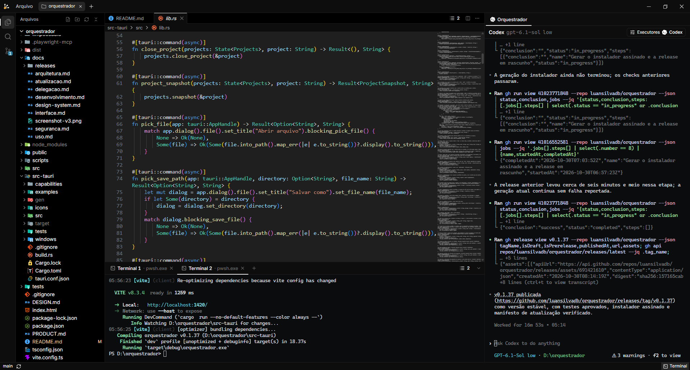

# Orquestrador



App nativo para Windows (Rust e GPUI) que põe CLIs de IA para trabalhar sobre a pasta de um projeto, de preferência um repositório Git. Um **orquestrador** conversa com você, lê o projeto e delega tarefas. Os **executores** recebem essas tarefas, cada um numa aba do painel, e trabalham na mesma pasta, em paralelo. Os CLIs `claude` e `codex` podem ocupar qualquer um dos dois papéis.

## Instalar

1. Baixe o instalador `Orquestrador_<versão>_x64-setup.exe` na [página da última release](https://github.com/luansilvadb/orquestrador/releases/latest) e execute-o. A instalação é por usuário, sem administrador.
2. Abra o app. Ele confere a versão e se atualiza sozinho quando há uma nova; depois instala ou atualiza os CLIs `claude` e `codex` ([detalhes](docs/atualizacao.md)).
3. Na primeira vez de cada CLI, faça o login pedido no terminal dele.

Requisitos:

- Windows 10 ou 11, 64 bits.
- Internet na abertura, para conferir o app e os CLIs.
- Conta no Claude e no ChatGPT para autenticar os CLIs. O app instala e atualiza os dois; a autenticação fica com você.
- Git (recomendado). Sem ele, o app abre a pasta, mas sem os recursos de Git.

## Usar

1. Escolha a pasta do projeto. Uma pasta fora de repositório também abre, sem os recursos de Git.
2. No painel do Orquestrador, à direita, clique em `Abrir terminal`, escolha ferramenta, modelo e esforço, e converse com ele até fechar o objetivo.
3. Quando ele delega, cada executor ganha uma aba. A resposta volta sozinha ao orquestrador quando o executor termina.

O passo a passo e a configuração estão em [uso](docs/uso.md), o comportamento da tela em [interface](docs/interface.md) e as decisões da delegação em [delegação](docs/delegacao.md).

> **Atenção:** os executores têm permissão total na pasta do projeto (Claude em `bypassPermissions`, Codex sem sandbox), e o orquestrador faz stage e commit dentro da alçada dele e consulta você antes de push. Abra só pastas em que você confia. Os limites estão em [limites de segurança](docs/seguranca.md).

## Desenvolvimento

```powershell
cargo run -p orquestrador-app
cargo test --workspace
```

Preparação da máquina, testes com CLIs reais e empacotamento em [desenvolvimento](docs/desenvolvimento.md).

## Contribuir

- Antes de mudar o código, leia [arquitetura](docs/arquitetura.md): regras que o compilador não impõe e decisões de projeto.
- Mudanças nas permissões dos agentes pedem cuidado. As permissões ficam só em `cli.rs` e a regra de cada papel só em `roles.rs`. O resumo está em [limites de segurança](docs/seguranca.md).
- Para publicar uma versão, siga [atualização e release](docs/atualizacao.md).

## Documentação

| Documento | Conteúdo |
| --- | --- |
| [uso](docs/uso.md) | Passo a passo, aviso de Git ausente, configuração e teto de executores |
| [interface](docs/interface.md) | Comportamento das telas, painéis, editor, mídia, pesquisa, Git e terminais |
| [delegação](docs/delegacao.md) | Decisões, limites aceitos e medições da delegação |
| [limites de segurança](docs/seguranca.md) | Permissões e alçada dos agentes, Git do painel, CLIs na abertura e rede |
| [atualização e release](docs/atualizacao.md) | Decisões, limites e medições da atualização automática, chave de assinatura e publicação |
| [arquitetura](docs/arquitetura.md) | Regras que o compilador não impõe e decisões de projeto |
| [desenvolvimento](docs/desenvolvimento.md) | Preparar a máquina, testes com CLIs reais e empacotamento |
| [design system](docs/design-system.md) | Referência visual e regras de componentes |
| [desempenho do GPUI](docs/desempenho-gpui.md) | Medições de latência de digitação e RAM do terminal |
| [notas de release](docs/releases/README.md) | Política de versão, modelo das notas e checklist de release |
